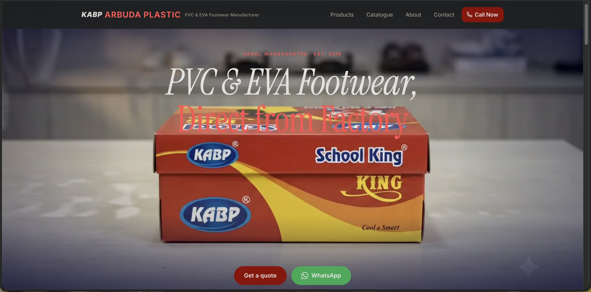

# Arbuda Plastic

Official website for **Arbuda Plastic (KABP)** — a PVC & EVA footwear manufacturer based in Vasai East, Maharashtra, established in 2014.

**Live site:** [arbudaplastic.co.in](https://www.arbudaplastic.co.in/)



## About

Arbuda Plastic manufactures and wholesales PVC and EVA footwear under its own brand (KABP) — slippers, sandals, and school shoes — direct from its own factory. The site serves wholesale distributors, retailers, and export agents sourcing footwear in bulk across India.

## What the site does

- **Product catalog** — 45 styles across PVC and EVA footwear, with colours per style and category and size filters, organized for quick scanning by a B2B buyer, with a downloadable PDF catalogue
- **Production journey** — a photo strip of the actual factory floor (raw material → moulding → finishing → dispatch), plus a registered-facility card tying back to the GSTIN
- **Lead capture** — phone, WhatsApp (pre-filled message), and email, visible at every scroll depth
- **Trust signals** — founding year, full factory address, GSTIN, minimum order quantities, IndiaMART and Facebook presence, warranty/return policy
- **No cart, no checkout** — by design. The product is the enquiry, not a transaction

## Tech

- Vanilla HTML/CSS/JS — no framework, no bundler, no npm dependencies
- Hosted on GitHub Pages with a custom domain (`CNAME`)
- WebP images with lazy-loading below the fold and responsive `srcset`; self-hosted, preloaded woff2 fonts (no Google Fonts request)
- JSON-LD `Manufacturer` structured data on the homepage and a 45-item `Product` list on the catalogue page (no prices, enquiry only), Open Graph tags, single-H1 hierarchy
- Strict Content Security Policy (no `unsafe-eval`, fonts and scripts from `'self'` plus Cloudflare Web Analytics only), `nosniff`, strict `Referrer-Policy`, locked-down `Permissions-Policy`, set via `<meta>` since GitHub Pages cannot send custom headers
- WCAG AA — contrast-checked tokens, focus rings, ARIA landmarks, inert modal when closed, 44px minimum touch targets, reduced-motion support

## Lighthouse scores

Measured on the live site with Lighthouse mobile emulation, 2026-10-16.

| Page | Performance | Accessibility | Best Practices | SEO | LCP | CLS |
|------|-------------|---------------|----------------|-----|-----|-----|
| Home | 97 | 100 | 96 | 100 | 2.3 s | 0 |
| Products | 93 | 100 | 96 | 100 | 2.5 s | 0 |

Best Practices stays at 96 because GitHub Pages cannot send security headers (HSTS, `X-Frame-Options`).

## Design principles

Built for a wholesale buyer scanning for a supplier, not a retail shopper browsing a brand. Direct, plain-spoken copy. Credibility over decoration. Optimized for 4G Indian mobile connections — no heavy dependencies.

## Structure

```
index.html          Homepage — hero, product highlights, production journey, trust signals, contact
products.html        Full product catalog
Products/             Product card thumbnails
Products/photos/      Product modal gallery images
assets/js/            Page scripts (main.js, products.js)
assets/fonts/         Self-hosted woff2 fonts
assets/factory/       Factory production photos (About section)
arbuda-catalogue.pdf   Downloadable product catalogue
sitemap.xml, robots.txt  Search engine crawl files
CNAME                 Custom domain config for GitHub Pages
```

## Status

Live and stable. Maintained on an as-needed basis.

## License

All rights reserved. See [LICENSE](LICENSE).

---

© Arbuda Plastic. All rights reserved.
